 

### 👨‍💻 Обо мне

🔸 **Больше 10 лет строю нефтяные и газовые скважины.** Помотался по северам, прошёл путь от технолога до заместителя руководителя проекта. Строил скважины на Ковыкте — крупнейшем газовом месторождении Восточной Сибири, занимался проектированием разработки трудноизвлекаемых запасов в Волго-Уральском регионе. Выстраивал процессы, организовывал работу людей и подрядчиков, оптимизировал строительство. Под моим руководством сроки строительства скважин сокращались больше чем на 10% из года в год, росли культура производства и качество работ.

🔸 **В 2026 году окончил курс «Аналитик данных»** в [karpov.courses](https://karpov.courses), работаю на Python и SQL. Потом подсел на вайбкодинг — работу в паре с ИИ-агентом — и увлёкся велоспортом.

🔸 **Придумал и развиваю «Дядю Грэвела»** — гравийное велосообщество и серию гонок в Самаре. Механику серии построил на [собственной аналитике](https://github.com/oiltsar/gravel-series-analytics) любительского велоспорта в России.

🔸 📍 Живу в Самаре · открыт к предложениям: удалёнка или гибрид.

### 🤘 Умею

🔸 **Делать дашборды и презентации для людей, которые принимают решения** — так, чтобы из каждого слайда было понятно, что делать дальше

🔸 **Руководить людьми и подрядчиками** — ставить задачи, договариваться, доводить до результата. Разговаривать с заказчиком на его языке

🔸 Находить, где теряются время и деньги: план и факт, НПВ, повторяющиеся отказы, план и карта рисков

🔸 Считать продуктовые метрики: retention, когорты, воронки, aha-момент

🔸 Проверять гипотезы: регрессия, доверительные интервалы, бутстрэп, дизайн A/B-теста и расчёт мощности (MDE)

🔸 Собирать данные из API, сайтов и Telegram-каналов и сводить людей между источниками, где нет общего идентификатора

🔸 Строить модель данных и SQL-витрины (DuckDB, SQLite) и пайплайн, который воспроизводится одной командой

🔸 Автоматизировать рутинную отчётность на Python: ежедневные сводки, Excel, PDF

### 🤖 Работаю с ИИ

🔸 Веду проекты в паре с ИИ-агентом **Claude Code**: ставлю задачу как техзадание — контекст, критерии готовности, ограничения, — а агент пишет код, собирает данные и считает. Код, данные и выводы остаются в git, расчёт повторяется одной командой

🔸 Проверяю результат, а не верю на слово: сверяю цифры с источником, смотрю случайные выборки, ищу, где модель могла ошибиться. Так в анализе велогонок нашлись ложные совпадения городов и каналов, которые автоматическая разметка принимала за велосипедные

🔸 Собираю инструмент под задачу за вечер: сборщик данных, генератор ежедневной сводки, дашборд, презентацию

🔸 Слежу за данными: персональные данные и ключи не уходят в публичные репозитории, витрины для портфолио собираю отдельно от рабочих

### 🛠️ Языки и инструменты

### 📁 Проекты

| Проект | О чём | Стек |
|---|---|---|
| 🚴 [**Русская гравийная серия как продукт**](https://github.com/oiltsar/gravel-series-analytics) | Захотел понять, как в России растёт гравийная культура, и разобрал главную гравийную серию страны: 28 этапов, 6 279 результатов, 2 972 гонщика за 2023–2026 годы. Нашёл, что серия делится на два региональных кластера и участники одного не могут набрать стартов для общего зачёта, что главный рычаг удержания — второй старт в первом сезоне (шансы вернуться выше в 2,7 раза), и спроектировал A/B-тест. Вышел с этим к организаторам: отчёт им понравился, и они попросили разобрать ещё одну серию. Этот проект стал толчком к изучению велоспорта России и к запуску «Дяди Грэвела». [Дашборд](https://oiltsar.github.io/gravel-series-analytics/dashboard/) и презентация | **Python** **pandas** **statsmodels** **DuckDB** **SQL** **HTML/JS-дашборд** |
| 🛢️ [**НПВ при строительстве скважин Volve**](https://github.com/oiltsar/drilling-time-volve) | Показал на открытых данных, чем занимаюсь в бурении. Разобрал 1 758 суточных рапортов месторождения Volve так, как ведёт учёт руководитель проекта: каждую операцию отнёс к виду НПВ и причине, собрал историю отказов по узлам, посчитал план НПВ и карту рисков на следующую скважину. И ответил на вопрос, что дал бы такой учёт с первой скважины: повторяющиеся отказы трубного манипулятора были видны с первого месяца, а решили их на третий год — это 17 суток станка. План НПВ, посчитанный по прошлым скважинам, выдержали 14 скважин из 16 | **Python** **pandas** **DuckDB** **SQL** **бутстрэп** |
| 🛒 [**X-ray Olist**](https://github.com/oiltsar/X-ray_Olist) | Учебный кейс, в котором я вышел за рамки задания и посмотрел на маркетплейс шире. Почему он не растёт: retention первого месяца — около 0,5%, выручка держится только на привлечении новых покупателей. Гипотезы приоритизированы по ICE, предложена система метрик для продакт-менеджера | **Python** **pandas** **seaborn** |
| 🗺️ [**Велогонки России: что удерживает гонщиков**](https://github.com/oiltsar/russia-cycling-analytics) *(в работе)* | Публичная часть моего исследования любительского велоспорта России. 242 тыс. стартов и 58 тыс. гонщиков из шести площадок без общего идентификатора, свои сборщики под каждую. Второй старт в первые 60 дней добавляет к возврату около 32 п.п. (дважды устойчивая оценка), сеть из 264 серий распадается на 23 почти не связанных сообщества. Основная работа идёт в приватном репозитории: там я ищу инсайты и векторы развития для своего проекта. [Дашборд](https://oiltsar.github.io/russia-cycling-analytics/) | **Python** **LightGBM** **SHAP** **причинный вывод** **анализ выживаемости** **NetworkX** **Plotly** |

### 🛢️ Из нефтегаза — то, что переносится в аналитику

🔸 **Оптимизация строительства скважин** (Ковыктинское месторождение): сроки −15% (2021 к 2020) и ещё −11% (2022 к 2021). Аварийность снижена больше чем на 25%: пересобрали графики «глубина — день» и карты рисков, разобрали причины НПВ.

🔸 **Учёт и затраты:** за 2018 год аварий с бурильной колонной стало на 28% меньше (пересмотрели регламенты и учёт наработки), расход талевого каната снизился на 23%, затраты отдела на прочие МТР за 2016–2017 годы — на 16%.

🔸 **Геомеханика** — стык аналитики и бурения. Прошёл обучение и применял в проектировании разработки трудноизвлекаемых запасов: по данным бурения и геофизики строится модель напряжений в породе, по ней выбирают плотность бурового раствора и траекторию, чтобы ствол не обваливался и раствор не уходил в пласт.

🔸 **Отчётность и автоматизация:** статистика и презентации для руководства, заказчиков и Росстата. Сейчас — генераторы ежедневной сводки, расчёт показателей для актов сверки (план и факт, НПВ по видам), рабочая документация на Python.

Курс «Аналитик данных», <a href="https://karpov.courses">karpov.courses</a>, 2025–2026 · Самарский государственный технический университет, бурение нефтяных и газовых скважин, 2015

